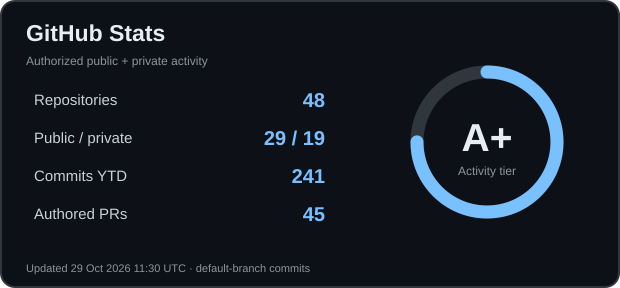

# Faizan Ullah

### Senior Mobile Engineer (Flutter) · Constelle Business Solutions · FinTech & Telco

**6+ years building secure, maintainable, production-grade software across Android, iOS, and the web.**

[Portfolio](https://faizanullah.dev) · [LinkedIn](https://www.linkedin.com/in/faizanullah1) · [Projects](https://github.com/FaizanUllahDev?tab=repositories) · [Pull Requests](https://github.com/pulls?q=is%3Apr+author%3AFaizanUllahDev)

 

---

## What I build

I am a **Senior Mobile Engineer (Flutter) at Constelle Business Solutions**, specializing in scalable Flutter applications for high-volume **FinTech and telecom** products. My experience spans secure financial workflows, digital self-care, payment integrations, retail/POS systems, and native Android/iOS engineering.

- **Secure mobile engineering:** Android/iOS native modules, platform channels, secure storage, DexGuard/iXGuard hardening, and protection against reverse engineering and tampering.
- **Architecture & quality:** Clean Architecture, MVVM/MVI, SOLID, BLoC/GetX/Cubit/Riverpod, TDD, and automated testing.
- **Delivery:** Release engineering, CI/CD, Fastlane, Docker, and cross-functional collaboration.
- **Current direction:** AI-assisted development with human review gates, system design, distributed systems, and solution architecture.

### Professional experience

**Senior Mobile Engineer (Flutter) — Constelle Business Solutions**  
*August 2026 – Present · Islamabad, Pakistan · On-site*

- Architecting scalable, high-performance Flutter applications for high-volume fintech and telecom ecosystems.
- Securing Android/iOS mobile builds with DexGuard and iXGuard to mitigate reverse engineering and tampering risks.
- Using AI-assisted tools in engineering workflows and product feature development.
- Improving maintainability and delivery with Clean Architecture, BLoC/GetX, and automated CI/CD.

**Featured product: Yas App** — Telecom digital self-care, account management, and secure payment experiences built with Flutter.

**Senior Mobile Engineer (Flutter) — Veroke**  
*November 2024 – August 2026 · Islamabad, Pakistan · On-site*

- Built security-focused fintech mobile solutions for the Saudi market, integrating SADAD and Tarabut payment flows and supporting compliance requirements.
- Applied test-driven development to critical financial transaction workflows.
- Implemented iOS/Android release automation with Fastlane and GitHub Actions, secure code signing, and multi-environment versioning.
- Improved mobile application startup and transaction performance through targeted profiling and architecture optimizations.

**Featured product: American Express KSA** — Production fintech application supporting secure transactions, enterprise integrations, and localization.

**Earlier experience — DTEK.ai**  
Worked on cross-platform retail, cashier/kiosk, POS, and operational dashboard products, including payment peripheral integrations and realtime functionality.

*Enterprise client and employer source code is proprietary; public repositories below contain independently shared projects.*

## GitHub Stats

**Contribution activity · last 90 days (public data)**

The stats card updates from [GitHub Actions](.github/workflows/profile-metrics.yml) using your authorized token. It aggregates public and accessible private repositories without publishing private names, contents, or individual activity. **Commits YTD** counts authored commits on accessible default branches since January 1, not every branch or every GitHub contribution. The 90-day public activity trend uses a separate data provider and may be cached. The circular activity tier is computed from documented commit/PR thresholds rather than inferred code quality.

**Activity tier:** A+ means at least 200 authored default-branch commits this year **and** 25 authored PRs; A means 100 commits and 10 PRs; B means 25 commits or 5 PRs; otherwise C. This is an illustrative activity tier, **not a GitHub-issued rating or a code-quality assessment**.

**Explore:** [Authored pull requests](https://github.com/pulls?q=is%3Apr+author%3AFaizanUllahDev) · [Commit search](https://github.com/search?q=author%3AFaizanUllahDev&type=commits) · [Contributions](https://github.com/FaizanUllahDev)

## Selected public projects

| Project | What it demonstrates |
| :--- | :--- |
| [Flutter Bot Team Kit](https://github.com/FaizanUllahDev/flutter-bot-team-kit) | Open-source, human-gated AI engineering workflow for Flutter teams, from requirements to QA. |
| [CivicPocket](https://github.com/FaizanUllahDev/civicpocket) | In-progress public-service discovery platform for Pakistan; Flutter app and secure backend foundations. |
| [VPN Architecture & Client](https://github.com/FaizanUllahDev/vpn) | Flutter MVVM/Clean Architecture scaffold, WireGuard planning, security, infrastructure, and cost design. |
| [Zaiqa AI](https://github.com/FaizanUllahDev/zaiqa-ai) | AI-enabled culinary product exploration with multimodal/Gemini integration. |

## Engineering toolkit

| Discipline | Technologies & practices |
| :--- | :--- |
| **Mobile** | Flutter, Dart, Kotlin, Swift, platform channels, Android, iOS |
| **Architecture** | Clean Architecture, MVVM, MVI, SOLID, BLoC/Cubit, Riverpod |
| **Security & fintech** | Secure storage, Android Keystore, iOS Keychain, app hardening, OAuth, API integrations |
| **Backend & real time** | Firebase, Supabase, REST APIs, WebSockets, Socket.IO, SignalR |
| **Quality & delivery** | TDD, unit/widget/integration tests, Fastlane, Docker, Azure DevOps, GitLab CI |
| **AI** | Gemini API, AI development workflows, TensorFlow Lite, applied ML |

## Let's connect

For mobile architecture, secure fintech engineering, AI-powered products, and engineering collaboration:

**[Portfolio](https://faizanullah.dev)** · **[LinkedIn](https://www.linkedin.com/in/faizanullah1)** · **[GitHub](https://github.com/FaizanUllahDev)**

Build reliable systems. Keep architecture intentional. Make improvements measurable.
